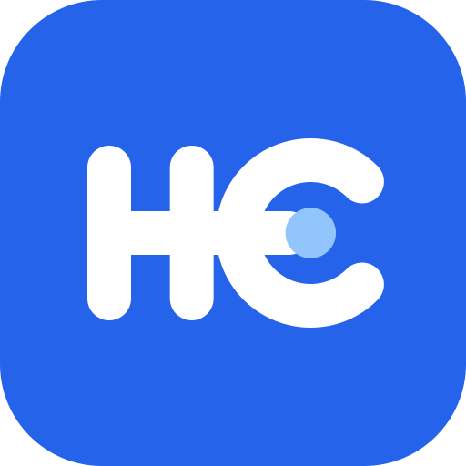

<p align="center">
  
</p>

<h1 align="center">HCDrive</h1>

<p align="center">
  Cổng lưu trữ đám mây tự triển khai: gộp nhiều tài khoản Google Drive và bucket S3 thành một ổ đĩa duy nhất,<br />
  truyền dữ liệu trực tiếp qua máy chủ mà không ghi tệp xuống ổ cứng.
</p>

<p align="center">
  <a href="LICENSE"></a>
  
  
  
  
</p>

<p align="center">
  <b>Tiếng Việt</b> · <a href="README_EN.md">English</a>
</p>

<p align="center">
  <a href="#bắt-đầu-nhanh">Bắt đầu nhanh</a> ·
  <a href="#tính-năng">Tính năng</a> ·
  <a href="DOCS-GIAO-DIEN-DEMO.md">Demo Giao diện</a> ·
  <a href="#cấu-hình">Cấu hình</a> ·
  <a href="#kiến-trúc">Kiến trúc</a> ·
  <a href="#api">API</a> ·
  <a href="#xử-lý-sự-cố">Xử lý sự cố</a>
</p>

---

## Giới thiệu

Mỗi tài khoản Google miễn phí có 15 GB. Khi dùng nhiều tài khoản, dữ liệu bị chia nhỏ: tài khoản này đầy trong khi tài khoản khác còn trống, và phải đăng nhập qua lại để tìm tệp.

**HCDrive** (trước đây là 9Drive) giải quyết việc đó bằng một máy chủ bạn tự chạy:

- **Một ổ đĩa cho mọi tài khoản.** Các tài khoản Google Drive và bucket S3 hiện chung trong "Drive của tôi"; thư mục cùng tên ở nhiều tài khoản được gộp thành một.
- **Không lưu tệp trên máy chủ.** Tải lên và tải xuống đi thẳng giữa trình duyệt và Google Drive / S3; máy chủ chỉ giữ thông tin tệp (tên, vị trí, kích thước).
- **Tự chọn chỗ lưu.** Tệp mới được đưa vào tài khoản còn nhiều chỗ nhất, lần lượt từng tài khoản, hoặc theo thứ tự ưu tiên bạn đặt.
- **Giao diện quen thuộc.** Thiết kế theo phong cách Material You, có chế độ sáng / tối, tiếng Việt và tiếng Anh, cài được như ứng dụng (PWA).

## Tính năng

### Lưu trữ

| | |
|---|---|
| **Nhiều nguồn lưu trữ** | Không giới hạn số tài khoản Google Drive; mọi dịch vụ tương thích S3 (Cloudflare R2, AWS S3, MinIO, Wasabi, Backblaze B2…). |
| **Theo dõi dung lượng** | Tổng dung lượng toàn hệ thống và chi tiết từng tài khoản, đồng bộ định kỳ. |
| **Phân bổ tải lên** | Ba chế độ: nhiều chỗ trống nhất, xoay vòng, theo thứ tự ưu tiên. Tài khoản hết chỗ hoặc đang bị Google giới hạn request được bỏ qua. |
| **Đồng bộ với Google Drive** | Dùng Changes API: chỉ hỏi Google những gì đã đổi, giảm số request và tránh lỗi "Quota exceeded". |
| **Chuyển tài khoản** | Xuất / nhập token tài khoản lưu trữ dưới dạng JSON để chuyển sang máy chủ khác. |

### Tệp và thư mục

- Tải lên tệp và cả thư mục (giữ nguyên cây thư mục con), tải lên tiếp tục được khi mạng chập chờn.
- **Sao chép sang Drive khác (Cross-Account Copy)**: Sao chép trực tiếp tệp hoặc cả thư mục từ tài khoản Google Drive này sang tài khoản Google Drive khác đã kết nối trong HCDrive qua menu ngữ cảnh chuột phải; truyền dữ liệu stream trực tiếp qua RAM (Zero Local Disk Buffering), không cần tải về máy tính rồi tải lên lại.
- Tải xuống thư mục hoặc nhiều tệp thành một file ZIP, nén trực tiếp trong lúc truyền.
- Chọn nhiều tệp (Shift / Ctrl + nhấp), thao tác hàng loạt: di chuyển, gắn dấu sao, xoá, khôi phục, tải ZIP.
- Xem trước ảnh, video, âm thanh, PDF, văn bản và tệp Office ngay trong trình duyệt.
- Tìm kiếm theo tên và theo nội dung tệp (full-text của Google Drive), lọc theo loại, tài khoản, ngày sửa, dung lượng.
- Thùng rác, gắn dấu sao, tệp gần đây.

### Tính năng của Google Drive

Tạo Google Docs / Sheets / Slides / Forms, xuất sang nhiều định dạng, tạo bản sao, lối tắt, bình luận, quản lý phiên bản, khoá tệp, chuyển quyền sở hữu, đặt hạn truy cập, chặn tải xuống, dọn thùng rác Google, tự chuyển tệp Office thành Google Docs khi tải lên.

### Chia sẻ

- Link chia sẻ công khai (có thể đặt hạn) kèm trang xem trước và chế độ nhúng.
- Chia sẻ trực tiếp với email qua quyền của Google Drive.
- Mời người dùng khác trong HCDrive xem hoặc chỉnh sửa.

### Quản lý Share (Khóa học & Thư mục chia sẻ)

Mục **Quản lý Share** (trước đây là Khóa học) quản lý các link Google Drive người khác chia sẻ cho email của bạn (khóa học đã mua, thư mục bài giảng, tài liệu dự án) hoặc chia sẻ qua link nội bộ / công khai:

- **Hai chế độ hiển thị linh hoạt (Dual-Mode)**: Tùy chọn tick checkbox *"Đây là khóa học"*:
  - *Nếu là khóa học*: Giao diện học tập tối ưu với trình phát đa phương tiện (Plyr player) liên tục, playlist danh sách bài, đánh dấu tích bài đã học, thanh phần trăm tiến độ và tự động chuyển bài tiếp theo.
  - *Nếu không phải khóa học*: Giao diện trình duyệt thư mục Google Drive chuẩn mực với đường dẫn Breadcrumb nhiều cấp, chuyển đổi chế độ xem Lưới / Danh sách, popup modal xem trước trực tiếp tài liệu/video/ảnh, tải từng tệp hoặc nén tải ZIP cả thư mục.
- **Lưu vào Drive đa tài khoản (Save to Drive)**: Người dùng có thể chọn bất kỳ tài khoản Google Drive nào đã kết nối trong HCDrive để lưu toàn bộ khóa học hoặc thư mục chia sẻ về Drive đó (không phụ thuộc vào email liên kết, truyền dữ liệu stream trực tiếp không tốn ổ cứng máy chủ).
- **Xem thông tin chi tiết**: Xem nhanh email người chia sẻ, tài khoản Google Drive đang liên kết và cấu hình quyền tải xuống.
- **Tự động bypass hạn chế tải xuống từ Google Drive**: Khi bài học hoặc tài liệu bị Google Drive chặn tải xuống hoặc chặn sao chép (`canDownload: false` / `canCopy: false`), HCDrive tự động kích hoạt cơ chế bypass trích xuất stream trực tiếp để người dùng vẫn xem và tải bài mượt mà.
- **Kiểm soát quyền tải xuống khi chia sẻ**: Chủ liên kết có thể bật hoặc tắt quyền tải xuống (`allowDownload: true / false`) khi tạo link chia sẻ nội bộ/công khai (`/library/s/:token`) — cho phép người nhận chỉ xem trực tuyến hoặc được phép tải về tùy ý.

### Quản trị và bảo mật

- Đăng nhập bằng email / mật khẩu hoặc Google; liên kết thêm đăng nhập Google cho tài khoản email.
- Quản lý phiên đăng nhập trên từng thiết bị, đăng xuất từ xa.
- Captcha cho đăng ký và đăng nhập: **Google reCAPTCHA v2** hoặc **Cloudflare Turnstile**, cấu hình trong giao diện.
- Tự nhận diện **Cloudflare** và **reverse proxy** (nginx, Docker) để lấy đúng IP người dùng.
- Giới hạn tần suất request, chống truy cập chéo dữ liệu (IDOR), nhật ký hoạt động.
- Quản lý người dùng, bật / tắt đăng ký, sao lưu và khôi phục cơ sở dữ liệu.
- Khoá API theo phạm vi quyền cho tích hợp bên ngoài.

## Bắt đầu nhanh

Cách được khuyên dùng là Docker: một container chứa cả frontend, backend và cơ sở dữ liệu SQLite, chạy trên một cổng.

**Yêu cầu:** Docker và Docker Compose.

```bash
git clone https://github.com/nhmt-hetcuu/HCDrive.git
cd HCDrive
cp .env.docker.example .env
```

Mở `.env` và đổi tối thiểu các giá trị sau:

```env
FRONTEND_URL=http://localhost:5173        # địa chỉ bạn mở HCDrive, ví dụ https://drive.example.com
JWT_ACCESS_SECRET=<chuỗi ngẫu nhiên, tối thiểu 32 ký tự>
TOKEN_ENCRYPTION_KEY=<chuỗi ngẫu nhiên, tối thiểu 32 ký tự>
INITIAL_USER_NAME=Admin                   # tên đăng nhập (đăng nhập bằng Username hoặc Email)
INITIAL_USER_EMAIL=admin@hcdrive.local    # email quản trị
INITIAL_USER_PASSWORD=<mật khẩu mạnh>     # nếu đổi trong .env, container tự đồng bộ khi restart
```

Tạo chuỗi ngẫu nhiên:

```bash
openssl rand -base64 48
```

Khởi chạy:

```bash
docker compose up -d --build
```

Mở **http://localhost:5173** và đăng nhập bằng tài khoản quản trị vừa đặt. Cơ sở dữ liệu nằm trong volume `hcdrive_data`; bảng mới được tạo tự động mỗi lần khởi động.

> [!IMPORTANT]
> Không dùng giá trị mặc định của `JWT_ACCESS_SECRET`, `TOKEN_ENCRYPTION_KEY` và `INITIAL_USER_PASSWORD` khi chạy thật. Đổi `TOKEN_ENCRYPTION_KEY` sau khi đã kết nối tài khoản sẽ làm các token đã lưu không giải mã được.

### Lệnh thường dùng

```bash
docker compose logs -f hcdrive      # xem log
docker compose restart hcdrive      # khởi động lại
docker compose up -d --build        # cập nhật sau khi git pull
docker compose down                 # dừng (dữ liệu vẫn còn trong volume)
```

## Cấu hình

### Biến môi trường

| Biến | Mô tả | Mặc định |
|---|---|---|
| `PORT` | Cổng trên máy chủ được ánh xạ vào container | `5173` |
| `FRONTEND_URL` | Địa chỉ người dùng mở HCDrive; dùng cho CORS và link chuyển hướng | `http://localhost:5173` |
| `DATABASE_URL` | Đường dẫn SQLite | `file:/app/data/hcdrive.db` |
| `JWT_ACCESS_SECRET` | Khoá ký access token, tối thiểu 32 ký tự | — |
| `TOKEN_ENCRYPTION_KEY` | Khoá mã hoá token Google và khoá S3, tối thiểu 32 ký tự | — |
| `ACCESS_TOKEN_TTL_SECONDS` | Thời hạn access token (giây) | `3600` |
| `REFRESH_TOKEN_TTL_DAYS` | Thời hạn phiên đăng nhập (ngày) | `30` |
| `MAX_UPLOAD_BYTES` | Dung lượng tối đa một tệp tải lên | `5368709120` (5 GB) |
| `ADMIN_EMAILS` | Email quản trị, phân cách bằng dấu phẩy; để trống thì người đăng ký đầu tiên là quản trị | — |
| `INITIAL_USER_NAME` / `_EMAIL` / `_PASSWORD` | Tự động tạo hoặc đồng bộ mật khẩu tài khoản quản trị khi khởi động (hỗ trợ đăng nhập bằng cả Email hoặc Username) | `Admin` / `admin@hcdrive.local` / `admin` |
| `GOOGLE_CLIENT_ID` / `_SECRET` / `_REDIRECT_URI` | OAuth client riêng (có thể nhập sau trong Cài đặt) | — |
| `TRUST_PROXY` | Để trống: tự nhận diện Cloudflare / nginx. Đặt `false` để không tin proxy nào | — |
| `RATE_LIMIT_MAX` / `RATE_LIMIT_WINDOW_MINUTES` | Số request API mỗi người dùng trong một khoảng thời gian | `2000` / `15` |
| `DISABLE_CAPTCHA` | `true` để tắt mọi kiểm tra captcha (khi lỡ nhập sai khoá) | — |
| `RECAPTCHA_SECRET_KEY` / `RECAPTCHA_SITE_KEY` | Cách cấu hình reCAPTCHA cũ; nên dùng **Cài đặt → Bảo mật** | — |

### Kết nối Google Drive

HCDrive có sẵn một OAuth client mặc định để thử ngay. Client này dùng chung hạn mức request với rất nhiều người, nên hay gặp lỗi *"Quota exceeded … Requests per minute"*. Khi dùng thật, hãy tạo OAuth client riêng (khoảng 10 phút):

1. Vào [Google Cloud Console](https://console.cloud.google.com/), tạo project mới.
2. **APIs & Services → Library**: bật **Google Drive API**.
3. **OAuth consent screen**: chọn *External*, điền tên ứng dụng và email; thêm các scope:
   ```text
   https://www.googleapis.com/auth/drive
   https://www.googleapis.com/auth/userinfo.email
   https://www.googleapis.com/auth/userinfo.profile
   ```
   Khi ứng dụng còn ở chế độ *Testing*, thêm các Gmail sẽ kết nối vào **Test users**.
4. **Credentials → Create credentials → OAuth client ID**, loại *Web application*:
   - *Authorized JavaScript origins*: giá trị `FRONTEND_URL`, ví dụ `https://drive.example.com`.
   - *Authorized redirect URIs*: `FRONTEND_URL` + `/connected-accounts/google/callback`.
5. Trong HCDrive: **Cài đặt → Google OAuth**, dán Client ID và Client Secret rồi lưu.

> [!NOTE]
> Google không chấp nhận redirect URI là địa chỉ IP nội bộ (ví dụ `http://10.0.0.200:5173`). Khi chạy trong mạng LAN không có tên miền, chọn cách **dán mã** trong hộp kết nối tài khoản: đăng nhập Google, sao chép mã hoặc link callback rồi dán vào HCDrive.

### Reverse proxy và Cloudflare

HCDrive tự nhận ra khi chạy sau Cloudflare hoặc một reverse proxy trong mạng nội bộ và chỉ tin header `X-Forwarded-For`, `X-Real-IP`, `CF-Connecting-IP` từ những địa chỉ đó. **Cài đặt → Bảo mật** cho biết HCDrive đã thấy gì và IP của bạn theo HCDrive.

Cấu hình nginx tối thiểu:

```nginx
server {
    server_name drive.example.com;

    location / {
        proxy_pass http://127.0.0.1:5173;
        proxy_set_header Host $host;
        proxy_set_header X-Real-IP $remote_addr;
        proxy_set_header X-Forwarded-For $proxy_add_x_forwarded_for;
        proxy_set_header X-Forwarded-Proto $scheme;

        # Tải lên / tải xuống tệp lớn: truyền thẳng, không đệm, không giới hạn kích thước
        proxy_request_buffering off;
        proxy_buffering off;
        client_max_body_size 0;
        proxy_read_timeout 1h;
        proxy_send_timeout 1h;
    }
}
```

Nhớ đặt `FRONTEND_URL` thành tên miền công khai (ví dụ `https://drive.example.com`) và khởi động lại container.

### Captcha

**Cài đặt → Bảo mật** (chỉ quản trị viên): chọn Google reCAPTCHA v2 hoặc Cloudflare Turnstile, dán Site key và Secret key, chọn bật khi đăng ký và / hoặc khi đăng nhập. HCDrive yêu cầu giải thử một captcha bằng khoá mới trước khi lưu, nên khoá sai không thể khoá trang đăng nhập. Nếu vẫn bị khoá ngoài, đặt `DISABLE_CAPTCHA=true` rồi khởi động lại.

## Phát triển cục bộ

**Yêu cầu:** Node.js 20 trở lên và npm.

```bash
# Tạo backend/.env và frontend/.env với khoá ngẫu nhiên, cài dependency
bash ./setup.sh                                          # Linux / macOS
powershell -ExecutionPolicy Bypass -File .\setup.ps1     # Windows

# Backend: http://localhost:4000
cd backend
npm run prisma:migrate
npm run dev

# Frontend: http://localhost:5173 (terminal khác)
cd frontend
npm run dev
```

Dự án chưa có bộ test tự động; trước khi gửi thay đổi, chạy kiểm tra kiểu và build:

```bash
cd backend && npm run build
cd frontend && npm run build
```

`AGENTS.md` và `CLAUDE.md` mô tả quy ước code, quy tắc bảo mật và danh sách API chi tiết.

## Kiến trúc

```text
Trình duyệt ── React 19 · Vite · Tailwind CSS 4 (PWA)
     │  HTTPS
     ▼
HCDrive backend ── Express 5 · TypeScript
     │  ├─ Xác thực: JWT + phiên, khoá API theo scope, captcha
     │  ├─ Hệ thống tệp: thư mục gộp nhiều tài khoản, tìm kiếm, chia sẻ, khóa học
     │  ├─ Phân bổ tải lên: đồng bộ dung lượng, chọn tài khoản, tránh tài khoản bị giới hạn
     │  └─ Truyền dữ liệu: stream thẳng tới / từ nhà cung cấp, không ghi đĩa
     │
     ├─ Prisma + SQLite ── thông tin tệp, thư mục, người dùng; token mã hoá AES, mật khẩu Argon2
     ├─ Google Drive API v3 ── tài khoản 1, 2, 3…
     └─ S3 API ── R2, AWS S3, MinIO, B2…
```

| Thư mục | Nội dung |
|---|---|
| `backend/src/modules/` | Route theo tính năng: `auth`, `files`, `folders`, `uploads`, `storage`, `google`, `s3`, `library`, `system`… |
| `backend/src/middleware/` | Xác thực, quyền quản trị, giới hạn tần suất, kiểm tra quyền sở hữu |
| `backend/src/utils/` | Mã hoá, captcha, nhận diện IP, URL ký, xử lý giới hạn request của Google |
| `backend/prisma/schema.prisma` | Lược đồ cơ sở dữ liệu |
| `frontend/src/pages/` | Các trang: Drive của tôi, Khóa học, Tài khoản lưu trữ, Cài đặt… |
| `frontend/src/components/` | Thành phần giao diện dùng chung |

## API

Tài liệu API tương tác đầy đủ có sẵn ngay trên giao diện ứng dụng tại **`/api-docs`** (hỗ trợ sao chép cURL, xem cấu trúc schema và mẫu request/response). Các route cần đăng nhập nhận header `Authorization: Bearer <accessToken>`.

| Nhóm | Route chính |
|---|---|
| Xác thực | `POST /auth/register`, `POST /auth/login`, `POST /auth/refresh`, `GET /auth/me` |
| Tài khoản lưu trữ | `GET /connected-accounts`, `POST /connected-accounts/s3`, `GET /storage/summary`, `PATCH /storage/routing-policy` |
| Thư mục | `GET /folders`, `POST /folders`, `PATCH /folders/:id`, `GET /folders/:id/download`, `POST /folders/copy-to-drive` |
| Tệp | `GET /files`, `GET /files/:id/download`, `PATCH /files/:id`, `POST /files/batch-download`, `POST /files/copy-to-drive` |
| Tải lên | `POST /uploads`, `POST /uploads/resumable/init` |
| Quản lý Share | `GET /library`, `POST /library`, `GET /library/:id/items`, `GET /library/shared/:token`, `POST /library/shared/:token/save`, `POST /library/:id/save-to-drive` |
| Tích hợp ngoài | `POST /api/v1/uploads` (khoá API có scope `files:upload`) |

Ví dụ tải tệp lên bằng khoá API (tạo khoá trong **Cài đặt → Khoá API**):

```bash
curl -X POST https://drive.example.com/api/v1/uploads \
  -H "Authorization: Bearer 9d_live_xxxxxxxx" \
  -F 'filesMeta=[{"fieldName":"file-0","fileName":"report.pdf","mimeType":"application/pdf","sizeBytes":"20480"}]' \
  -F "file-0=@./report.pdf;type=application/pdf"
```

## Bảo mật

- Token Google và khoá S3 được mã hoá AES trước khi lưu; mật khẩu băm bằng Argon2; refresh token, token chia sẻ và khoá API chỉ lưu bản băm.
- Mọi truy vấn dữ liệu người dùng lọc theo chủ sở hữu ngay trong câu truy vấn; id là UUID và trả về 404 cho bản ghi của người khác.
- Giới hạn tần suất cho đăng nhập, đăng ký và toàn bộ API, trả `429` kèm `Retry-After`.
- CORS chỉ cho phép `FRONTEND_URL`.
- Tệp không bao giờ được ghi xuống ổ cứng máy chủ.

Phát hiện lỗ hổng bảo mật? Vui lòng báo riêng qua [GitHub Security Advisories](https://github.com/nhmt-hetcuu/HCDrive/security/advisories/new) thay vì mở issue công khai.

## Xử lý sự cố

<details>
<summary><b>"Quota exceeded for quota metric 'Queries' … Requests per minute"</b></summary>

OAuth client đang dùng hết lượt request trong phút đó, thường gặp với client mặc định. HCDrive tự tạm dừng đồng bộ tài khoản đó một phút và chuyển tải lên sang tài khoản khác. Cách khắc phục lâu dài: tạo OAuth client riêng (xem [Kết nối Google Drive](#kết-nối-google-drive)), rồi mở **ⓘ Xem thông tin** của tài khoản và chọn **Kết nối lại bằng OAuth riêng**.
</details>

<details>
<summary><b>"Google Drive API has not been used in project … or it is disabled"</b></summary>

Bật **Google Drive API** trong đúng project chứa OAuth client (*APIs & Services → Library*), đợi vài phút rồi thử lại.
</details>

<details>
<summary><b>"Access blocked … Error 403: access_denied"</b></summary>

Ứng dụng OAuth đang ở chế độ *Testing*. Thêm email cần đăng nhập vào *OAuth consent screen → Test users*.
</details>

<details>
<summary><b>"redirect_uri_mismatch"</b></summary>

Redirect URI trong Google Cloud phải trùng chính xác `FRONTEND_URL` + `/connected-accounts/google/callback` (cả `http`/`https` và cổng). Với địa chỉ IP nội bộ, dùng cách dán mã.
</details>

<details>
<summary><b>Tải lên tệp lớn bị ngắt khi chạy sau nginx</b></summary>

Thêm `client_max_body_size 0;`, `proxy_request_buffering off;` và tăng `proxy_read_timeout` / `proxy_send_timeout` như cấu hình mẫu ở trên. Với Cloudflare gói miễn phí, mỗi request tải lên bị giới hạn 100 MB; HCDrive tải tệp lớn theo từng phần nên vẫn hoạt động.
</details>

<details>
<summary><b>Bị khoá ngoài vì captcha</b></summary>

Đặt `DISABLE_CAPTCHA=true` trong `.env`, chạy `docker compose up -d`, đăng nhập và sửa khoá trong **Cài đặt → Bảo mật**, rồi xoá biến đó.
</details>

<details>
<summary><b><code>prisma generate</code> báo khoá tệp trên Windows</b></summary>

Một tiến trình Node đang giữ tệp của Prisma. Dừng các dev server rồi chạy lại lệnh trong thư mục `backend/`.
</details>

## Đóng góp

Mọi đóng góp đều được hoan nghênh. Với thay đổi lớn, hãy mở issue để trao đổi trước. Pull request nên:

- giữ nguyên kiến trúc truyền thẳng (không ghi tệp xuống đĩa);
- build sạch cả `backend` và `frontend`;
- không chứa tệp `.env` hay bất kỳ khoá bí mật nào.

## Ủng hộ dự án

Nếu HCDrive hữu ích với bạn, bạn có thể ủng hộ tác giả để duy trì và phát triển dự án.

<p align="center">
  
</p>

| | |
|---|---|
| Ngân hàng | MB Bank (Ngân hàng TMCP Quân Đội) |
| Số tài khoản | `01001200910010` |
| Chủ tài khoản | NGUYEN HOANG MINH TRI |
| Nội dung | `Donate HCDrive` |

Cảm ơn bạn đã ủng hộ.

## Giấy phép

Phát hành theo giấy phép [Apache License 2.0](LICENSE).
